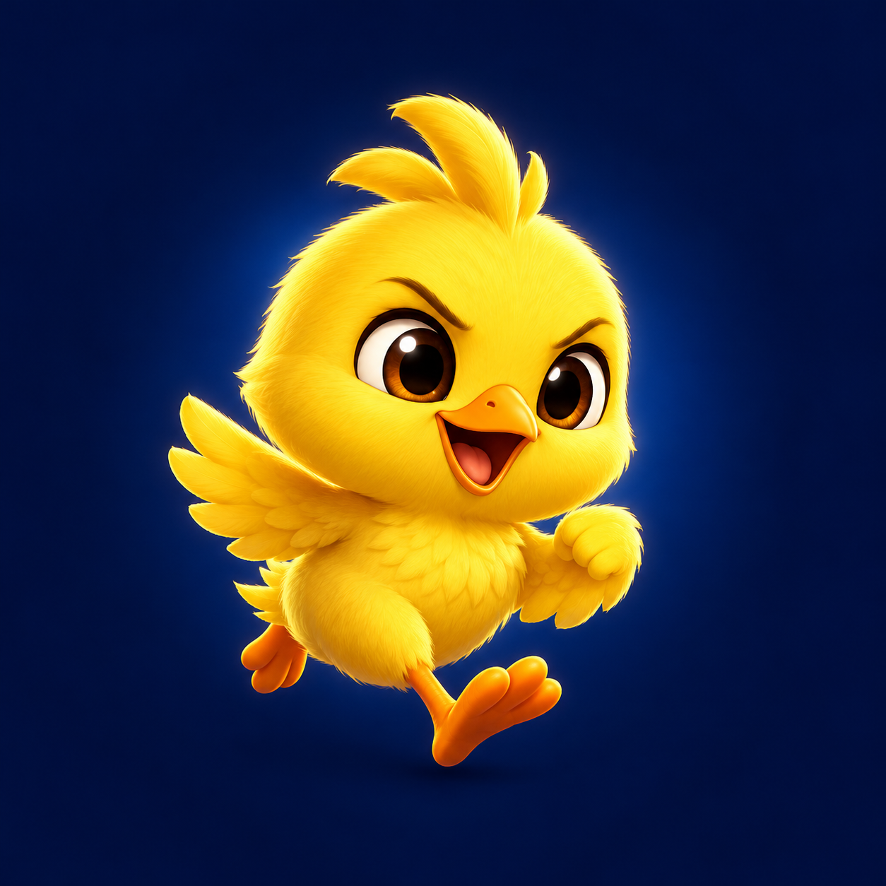
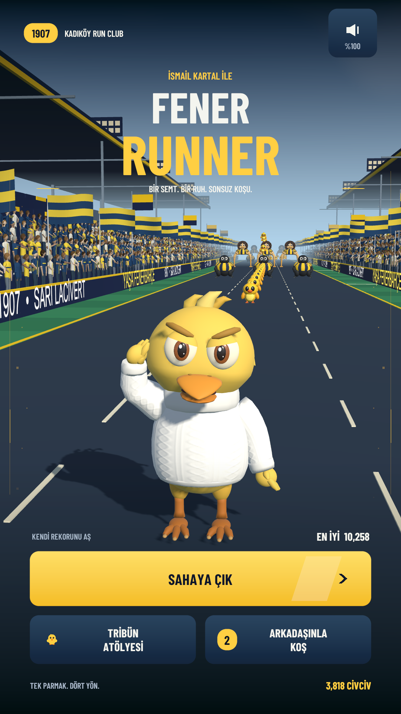
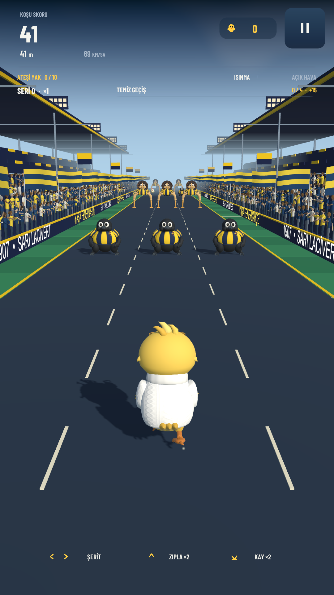
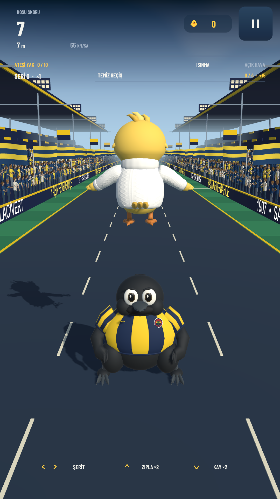
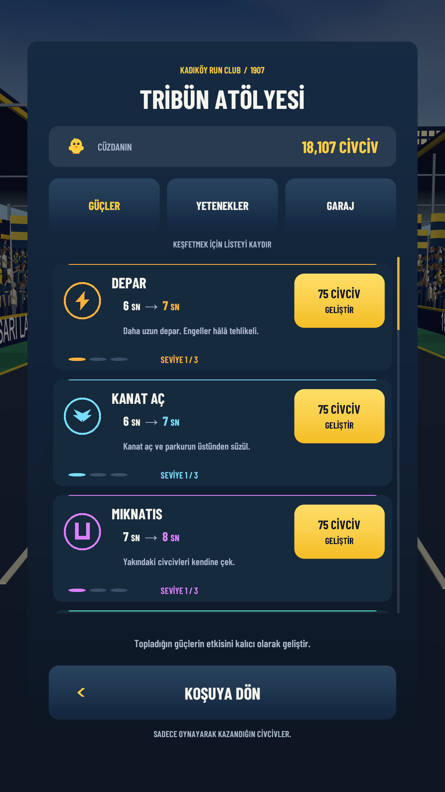
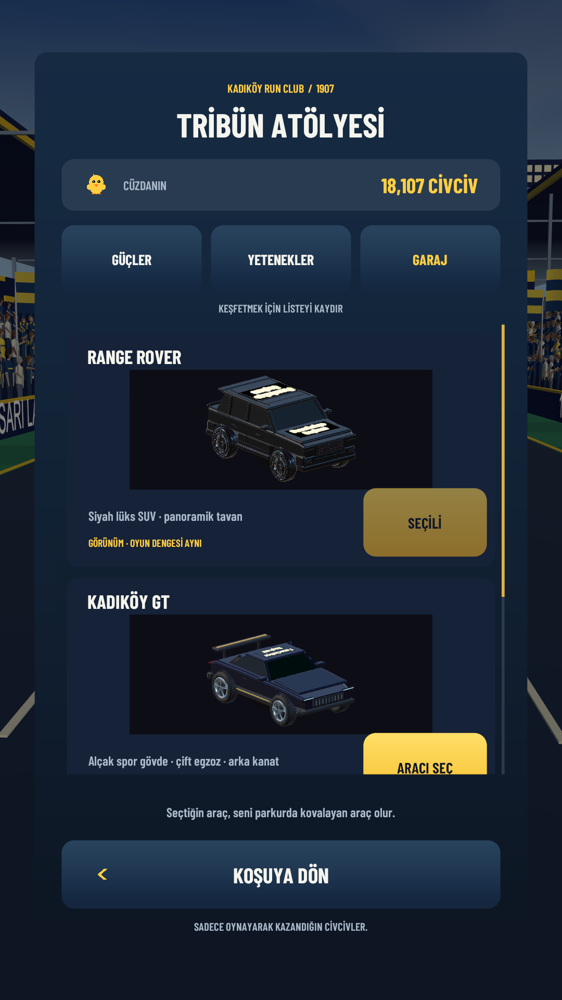
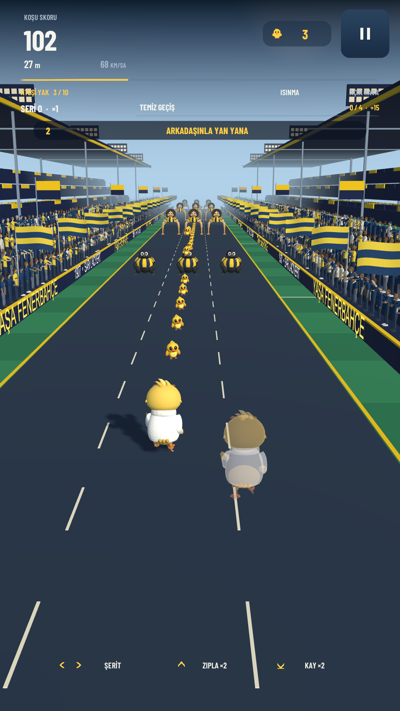

<p align="center">
  
</p>

<h1 align="center">Fener Runner</h1>

<p align="center"><strong>One district. One spirit. An endless run.</strong></p>
<p align="center">A portrait-first 3D mobile runner inspired by Fenerbahçe matchday culture, built with Unity.</p>

<p align="center">
  <strong>English</strong> · <a href="README.tr.md">Türkçe</a><br />
  <a href="https://github.com/ArdaHFO/Fener-Runner/releases/download/v0.20.0/FenerRunner-v0.20-arm64.apk"><strong>Download Android APK</strong></a> ·
  <a href="https://github.com/ArdaHFO/Fener-Runner/releases/tag/v0.20.0">Release notes</a> ·
  <a href="docs/INSTALL.md">Installation guide</a>
</p>

---

Swipe through a stadium corridor packed with animated supporters. Jump and slide through changing obstacle patterns, gather 3D chicks, combine power-ups, and turn your earnings into permanent upgrades. Invite a friend and race alongside their ghost on a shared course.

**v0.20.0 is a playable Android preview under active development.** The game interface is currently Turkish. This repository provides English and Turkish documentation. This is an independent fan project, with no official affiliation or endorsement implied.

## Play on Android

| Requirement | Current preview |
| --- | --- |
| Android | 8.0 or newer, 64-bit ARM device |
| Download | 34.8 MiB APK, no additional OBB file |
| Display | Portrait |
| Controls | Swipe left, right, up and down |
| Online play | Internet connection and the same game version on both devices |

1. Download [FenerRunner-v0.20-arm64.apk](https://github.com/ArdaHFO/Fener-Runner/releases/download/v0.20.0/FenerRunner-v0.20-arm64.apk) on your phone.
2. Open the APK and follow Android's installation prompts. If requested, allow installation from the app you used to open it.
3. Launch **Fener Runner** and tap **SAHAYA ÇIK** to begin.

Already using a compatible earlier build? Install this APK as an update to preserve local progress. See the [installation guide](docs/INSTALL.md) for compatibility, verification and troubleshooting.

## Inside the game

- **Movement with room to improve.** Three lanes, double jumps, repeat slides and a course that grows faster as a run progresses.
- **A lively matchday setting.** Animated spectators, flags, thrown crowd props, weather transitions and layered audio.
- **Collectible chicks.** Gather 3D chicks along the route. A rare hen scatters extra chicks for you to catch.
- **A three-tab workshop.** Upgrade 15 powers through three levels each, invest in five permanent abilities, and choose from three chase vehicles.
- **Power combinations.** Mix effects such as flight, magnetism, shields, score boosts and chick showers. Magnet and Double Chicks together reward clean obstacle passages with bonus chicks.
- **Ghost races with friends.** Create a room or send an in-game invitation. Each player runs independently while seeing the other as a ghost.
- **Persistent progress.** Earned chicks, upgrades and your selected vehicle are saved locally. Audio volume is adjustable.

Vehicles change the appearance of the animated pursuer without adding a gameplay advantage. Workshop purchases use chicks earned through play.

## Screenshots

Actual captures from the game running in Unity Editor, not concept art. The multiplayer image uses a controlled local network peer for the ghost preview. These are not captures from physical Android phones.

| Main menu | Stadium run | Jump |
| :---: | :---: | :---: |
|  |  |  |

| Power workshop | Vehicle garage | Ghost race preview |
| :---: | :---: | :---: |
|  |  |  |

## Controls

| Action | Phone | Unity Editor |
| --- | --- | --- |
| Change lane | Swipe left / right | Left / right arrow |
| Jump / double jump | Swipe up, then up again | Up arrow, then up again |
| Slide / repeat slide | Swipe down | Down arrow |
| Pause | Tap the pause icon | Click the pause icon |

Power-ups activate when collected. From the pause screen, **ANA MENÜYE DÖN** ends the run and returns to the menu, settling that run's earnings once.

## Run the project

Use **Unity 6000.3.0f1** with **Universal Render Pipeline 17.3.0**. Open the `UnityProject` directory through Unity Hub, then open:

```text
Assets/FenerRunner/Generated/Scenes/FenerRunner.unity
```

Press Play and choose **SAHAYA ÇIK**. The first import recreates the Unity cache and restores the pinned packages.

On Windows, the portable launcher selects Direct3D 11 for the Editor:

```powershell
.\scripts\open-unity.ps1 -UnityEditor "C:\Program Files\Unity\Hub\Editor\6000.3.0f1\Editor\Unity.exe"
```

Read the [development guide](docs/DEVELOPMENT.md) for Android builds, project structure and validation. Online development requires a configured Unity Gaming Services project. See [multiplayer setup](docs/MULTIPLAYER.md).

## Validation and current limits

The v0.20 baseline passed **2,993 verification conditions across 27 native Unity Play Mode stages**, followed by **41 APK checks** and **21 packaged-service checks**. These are project-specific regression conditions, not a count of Unity Test Framework test cases.

The downloadable APK is a non-development ARM64 build signed with a local debug key for preview installation. It is not a store release. Physical-phone performance, Android keyboard behavior and a two-phone play session have not yet been verified in the recorded test run. See [validation evidence and scope](docs/VALIDATION.md).

## Project map

```text
UnityProject/       Unity assets, C# code, packages and project settings
SourceAssets/      Supporting source assets
scripts/           Portable Editor and Android build helpers
docs/              Guides, screenshots and release documentation
```

## Documentation and contributions

- [Install and play](docs/INSTALL.md)
- [Develop and build](docs/DEVELOPMENT.md)
- [Friends and multiplayer](docs/MULTIPLAYER.md)
- [Validation](docs/VALIDATION.md) · [Privacy](docs/PRIVACY.md)
- [v0.20.0 release notes](docs/releases/v0.20.0.md)
- [Contributing](CONTRIBUTING.md) · [Changelog](CHANGELOG.md)

For a reproducible bug report, include the game version, device and Android version, the action sequence, and a screenshot or recording when useful. Avoid sharing account tokens or private player information. Small, focused changes with a clear description of their validation are easier to review.

## License and credits

Project code is distributed under the [MIT license](LICENSE). Third-party assets, fonts, audio, names and marks retain their respective rights and terms. See [third-party notices](THIRD_PARTY_NOTICES.md) before reusing or redistributing them.
