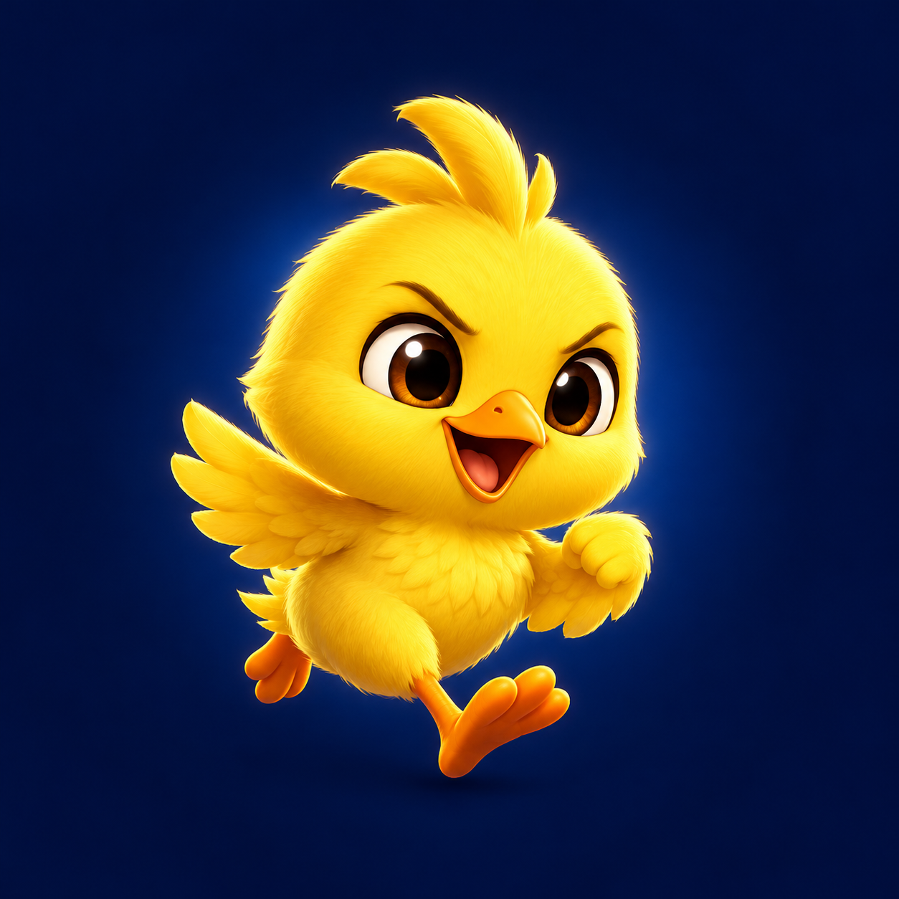
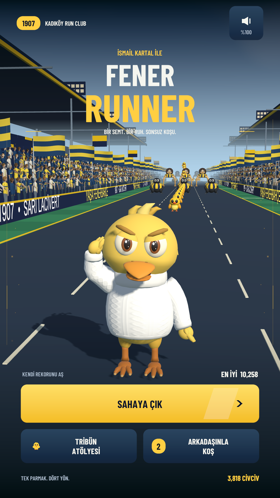
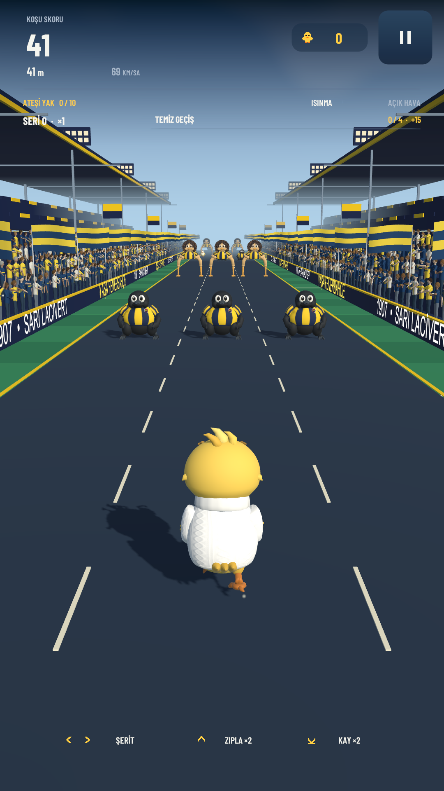
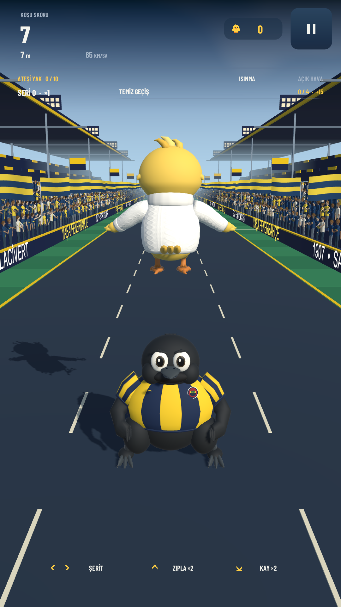
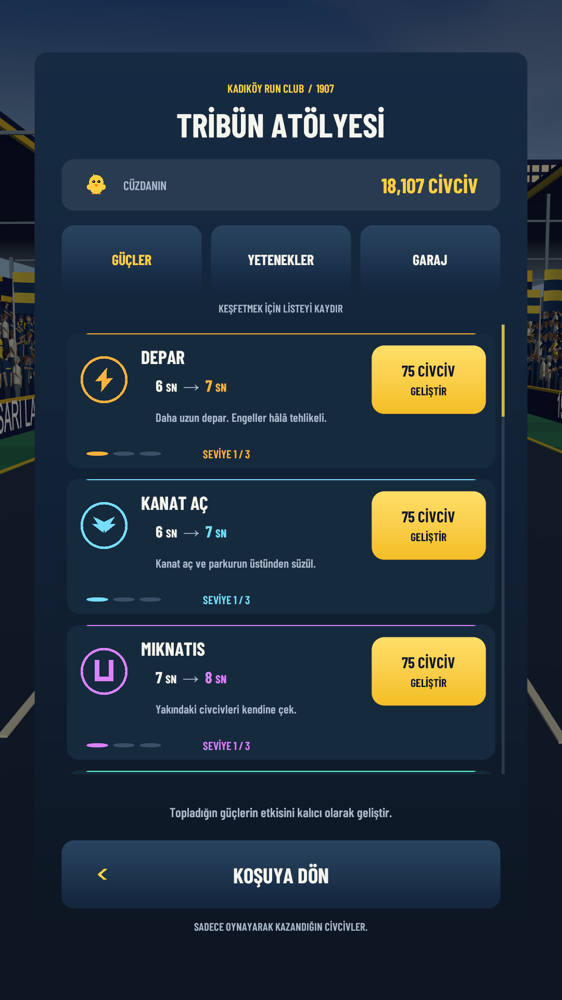
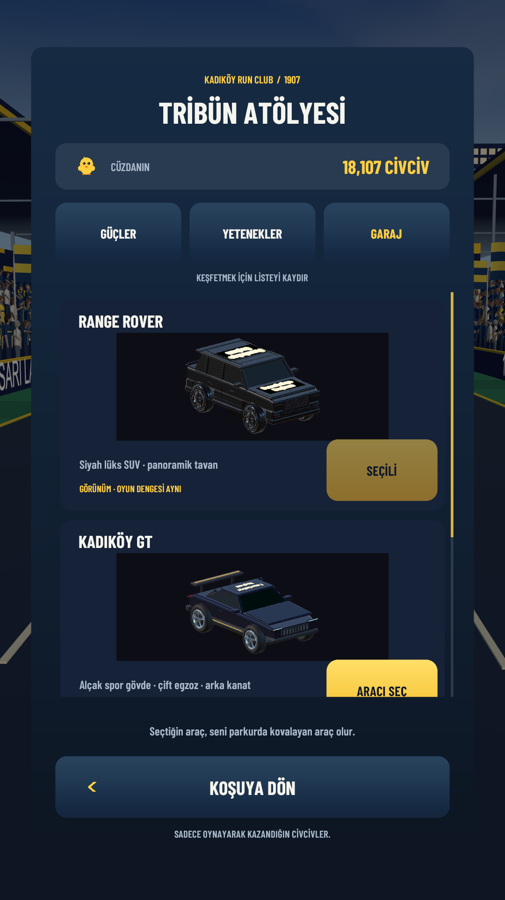
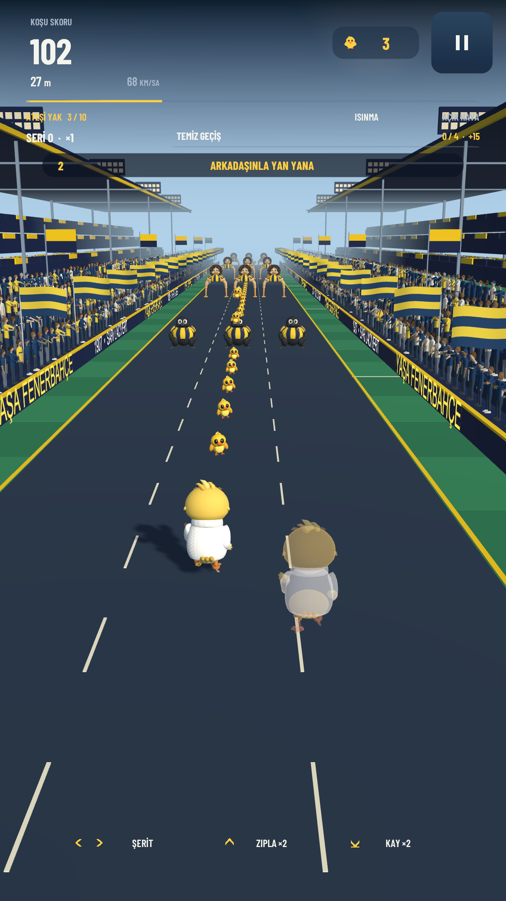

<p align="center">
  
</p>

<h1 align="center">Fener Runner</h1>

<p align="center"><strong>Bir semt. Bir ruh. Sonsuz koşu.</strong></p>
<p align="center">Unity ile geliştirilen, Fenerbahçe maç günü atmosferinden ilham alan, dikey ekranlı bir 3D mobil koşu oyunu.</p>

<p align="center">
  <a href="README.md">English</a> · <strong>Türkçe</strong><br />
  <a href="https://github.com/ArdaHFO/Fener-Runner/releases/download/v0.20.0/FenerRunner-v0.20-arm64.apk"><strong>Android APK'yı indir</strong></a> ·
  <a href="https://github.com/ArdaHFO/Fener-Runner/releases/tag/v0.20.0">Sürüm notları</a> ·
  <a href="docs/INSTALL.tr.md">Kurulum rehberi</a>
</p>

---

Hareketli taraftarlarla çevrili parkurda kaydırarak ilerle. Değişen engel dizilimlerinde zıpla ve kay, 3D civcivleri topla, güçleri birleştir ve kazandıklarını kalıcı geliştirmelere dönüştür. Arkadaşını davet ederek aynı parkurda onun gölgesiyle yan yana yarış.

**v0.20.0, geliştirilmesi süren oynanabilir bir Android önizleme sürümüdür.** Oyunun arayüzü Türkçedir. Bu repoda İngilizce ve Türkçe belgeler bulunur. Proje bağımsız bir taraftar çalışmasıdır ve resmî bir bağlantı veya onay iddiası taşımaz.

## Android'de oyna

| Gereksinim | Güncel önizleme |
| --- | --- |
| Android | 8.0 veya üzeri, 64 bit ARM cihaz |
| İndirme | 34,8 MiB APK, ek OBB dosyası gerekmez |
| Ekran | Dikey |
| Kontroller | Sağa, sola, yukarı ve aşağı kaydırma |
| Çevrimiçi oyun | Her iki cihazda internet ve aynı oyun sürümü |

1. Telefonuna [FenerRunner-v0.20-arm64.apk](https://github.com/ArdaHFO/Fener-Runner/releases/download/v0.20.0/FenerRunner-v0.20-arm64.apk) dosyasını indir.
2. APK'yı aç ve Android'in kurulum adımlarını izle. İstenirse dosyayı açtığın uygulamaya bu kaynaktan yükleme izni ver.
3. **Fener Runner**'ı başlat ve **SAHAYA ÇIK** düğmesine dokun.

Uyumlu bir önceki sürümü kullanıyorsan yerel ilerlemeni korumak için APK'yı güncelleme olarak kur. Uyumluluk, doğrulama ve sorun giderme ayrıntıları [kurulum rehberinde](docs/INSTALL.tr.md).

## Oyunda neler var?

- **Geliştikçe ustalaşan hareket sistemi.** Üç şerit, çift zıplama, art arda kayma ve koşu ilerledikçe hızlanan parkur.
- **Canlı maç günü atmosferi.** Hareketli taraftarlar, bayraklar, tribünden atılan nesneler, hava geçişleri ve farklı ses katmanları.
- **Toplanabilir civcivler.** Parkurdaki 3D civcivleri yakala. Ara sıra çıkan tavuk, toplayabileceğin ek civcivler saçar.
- **Üç sekmeli atölye.** 15 gücün her birini üç seviye geliştir, beş kalıcı yeteneğe yatırım yap ve üç takip aracından birini seç.
- **Güç birleşimleri.** Uçuş, mıknatıs, kalkan, skor çarpanı ve civciv yağmuru gibi etkileri birleştir. Mıknatıs ile Çift Jeton aynı anda etkinken temiz engel geçişleri bonus civciv çıkarır.
- **Arkadaşlarla gölge yarışı.** Oda kur veya oyun içinden davet gönder. Her oyuncu kendi koşusunu sürdürürken diğerini gölge olarak görür.
- **Kalıcı ilerleme.** Kazandığın civcivler, geliştirmeler ve seçili araç yerel olarak kaydedilir. Ses düzeyi ayarlanabilir.

Araçlar hareketli takipçinin görünümünü değiştirir ve oyun avantajı sağlamaz. Atölyedeki alışverişlerde oynayarak kazanılan civcivler kullanılır.

## Ekran görüntüleri

Bunlar Unity Editor'de çalışan oyundan alınmış gerçek görüntülerdir, konsept çizimleri değildir. Multiplayer görüntüsündeki gölge için kontrollü bir yerel ağ eş düğümü kullanılmıştır. Görüntüler fiziksel Android telefonlarından alınmamıştır.

| Ana menü | Tribünler arasında koşu | Zıplama |
| :---: | :---: | :---: |
|  |  |  |

| Güç atölyesi | Araç garajı | Gölge yarış önizlemesi |
| :---: | :---: | :---: |
|  |  |  |

## Kontroller

| Hareket | Telefon | Unity Editor |
| --- | --- | --- |
| Şerit değiştir | Sağa / sola kaydır | Sağ / sol ok |
| Zıpla / çift zıpla | Yukarı, ardından tekrar yukarı kaydır | Yukarı ok, ardından tekrar yukarı ok |
| Kay / art arda kay | Aşağı kaydır | Aşağı ok |
| Duraklat | Duraklatma simgesine dokun | Duraklatma simgesine tıkla |

Güçler toplandığında etkinleşir. Duraklatma ekranındaki **ANA MENÜYE DÖN**, koşuyu bitirerek menüye döner ve o koşunun kazancını bir kez cüzdana aktarır.

## Projeyi çalıştır

**Unity 6000.3.0f1** ve **Universal Render Pipeline 17.3.0** kullanılır. Unity Hub üzerinden `UnityProject` klasörünü aç, ardından şu sahneye geç:

```text
Assets/FenerRunner/Generated/Scenes/FenerRunner.unity
```

Play'e bas ve **SAHAYA ÇIK** seç. İlk açılışta Unity önbelleği yeniden oluşturulur ve sabitlenmiş paket sürümleri indirilir.

Windows'taki taşınabilir başlatıcı, Editor için Direct3D 11 kullanır:

```powershell
.\scripts\open-unity.ps1 -UnityEditor "C:\Program Files\Unity\Hub\Editor\6000.3.0f1\Editor\Unity.exe"
```

Android derlemesi, proje yapısı ve doğrulama için [geliştirme rehberine](docs/DEVELOPMENT.tr.md) bak. Çevrimiçi geliştirme için yapılandırılmış bir Unity Gaming Services projesi gerekir. Ayrıntılar [multiplayer rehberinde](docs/MULTIPLAYER.tr.md).

## Doğrulama ve mevcut sınırlar

v0.20 temel sürümü, **27 native Unity Play Mode aşamasında 2.993 doğrulama koşulunu**, ardından **41 APK kontrolünü** ve **21 paketlenmiş hizmet kontrolünü** geçti. Bunlar projeye özel regresyon koşullarıdır ve Unity Test Framework test sayısı anlamına gelmez.

İndirilebilir APK, önizleme kurulumu için yerel debug anahtarıyla imzalanmış, Development Build kapalı bir ARM64 derlemesidir. Mağaza sürümü değildir. Kaydedilen doğrulama çalışmasında fiziksel telefon performansı, Android klavyesi ve iki telefondan birlikte oyun henüz test edilmedi. [Doğrulama kapsamını ve kanıtlarını](docs/VALIDATION.md) inceleyebilirsin.

## Proje yapısı

```text
UnityProject/       Unity varlıkları, C# kodu, paketler ve proje ayarları
SourceAssets/      Destekleyici kaynak varlıklar
scripts/           Taşınabilir Editor ve Android derleme yardımcıları
docs/              Rehberler, ekran görüntüleri ve sürüm belgeleri
```

## Belgeler ve katkı

- [Kurulum ve oynanış](docs/INSTALL.tr.md)
- [Geliştirme ve derleme](docs/DEVELOPMENT.tr.md)
- [Arkadaşlar ve multiplayer](docs/MULTIPLAYER.tr.md)
- [Doğrulama](docs/VALIDATION.md) · [Gizlilik](docs/PRIVACY.md)
- [v0.20.0 sürüm notları](docs/releases/v0.20.0.md)

Tekrarlanabilir bir hata bildirimi için oyun sürümünü, cihazı ve Android sürümünü, soruna yol açan adımları ve yararlıysa ekran görüntüsü veya kaydını ekle. Hesap token'larını veya özel oyuncu bilgilerini paylaşma. Küçük, belirli bir konuya odaklanan ve nasıl doğrulandığını açıklayan değişiklikler daha kolay incelenir.

## Lisans ve kaynaklar

Projenin kodu [MIT lisansı](LICENSE) ile dağıtılır. Üçüncü taraf varlıklar, yazı tipleri, sesler, isimler ve markalar kendi haklarına ve koşullarına tabidir. Bunları yeniden kullanmadan veya dağıtmadan önce [üçüncü taraf bildirimlerini](THIRD_PARTY_NOTICES.md) incele.

[Katkı rehberi](CONTRIBUTING.md) · [Sürüm geçmişi](CHANGELOG.md)
